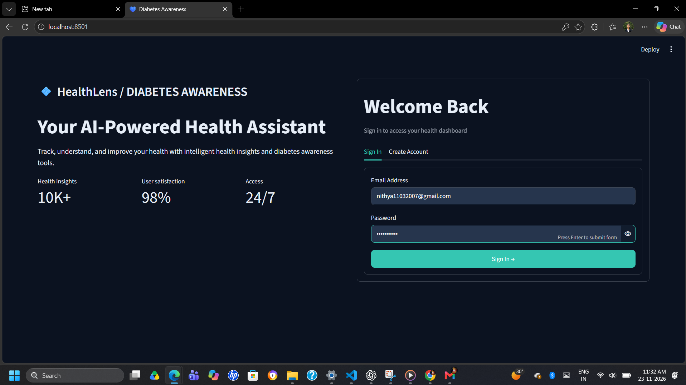
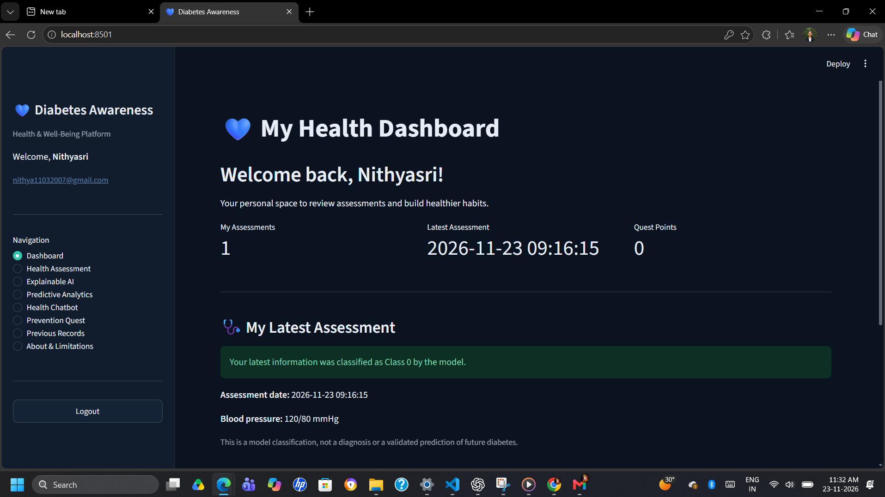
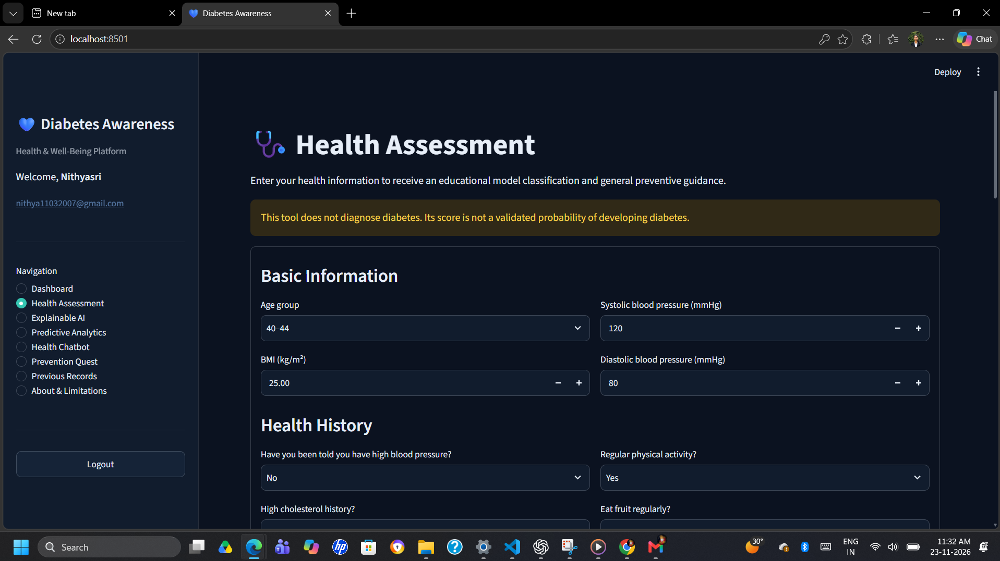
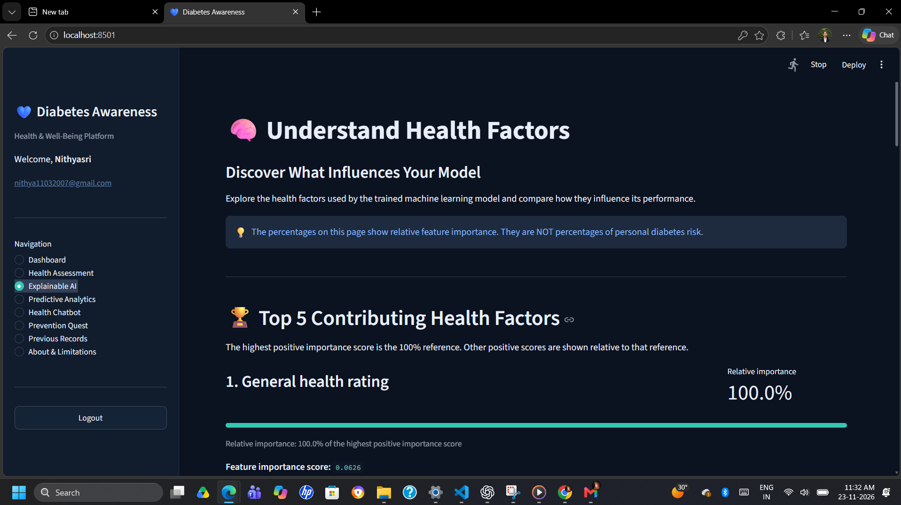
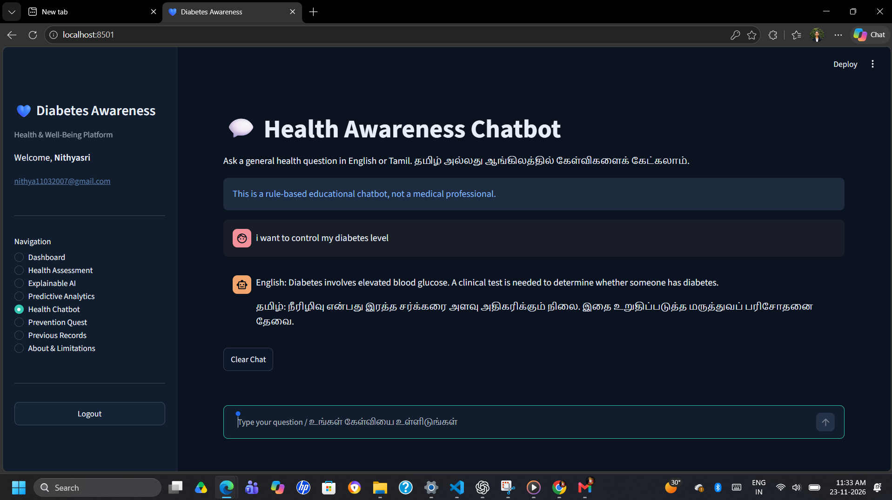

# 🩺 Diabetes Awareness – Explainable Machine Learning-Based Health Assessment Platform

An interactive health awareness platform built using Python, Streamlit, and Machine Learning. The application provides a diabetes-related health assessment, visual analytics, Explainable AI insights, and health awareness activities.

## 🌐 Live Demo

🚀 **Try the application here:**

[Diabetes Awareness – Live App](https://diabetes-awareness-app-rr5vjrpxuvomwbtypq3fna.streamlit.app/)

## 📌 Project Overview

Diabetes is a major public health concern. Early awareness of health indicators and healthy lifestyle choices can support better health management.

The **Diabetes Awareness Platform** is designed to help users explore diabetes-related health indicators through a machine learning-based assessment. It also provides understandable insights into model predictions and encourages healthy habits through interactive awareness activities.

This project was developed as a HealthTech solution to promote health awareness through technology.

## 🎯 Objectives

- Develop a machine learning-based diabetes health assessment application.
- Make model predictions easier to understand using Explainable AI.
- Present health-related information through interactive dashboards.
- Promote diabetes awareness and healthy lifestyle habits.
- Provide an accessible and interactive user experience.

## ✨ Key Features

### 1. 👤 User Authentication
- User registration and login.
- Individual user access to the application.

### 2. 📊 Interactive Dashboard
- Visual representation of health-related information.
- Interactive charts and analytics.
- Easy-to-understand dashboard interface.

### 3. 🩺 Diabetes Health Assessment
- Collects health-related information such as BMI, blood pressure, physical activity, and lifestyle indicators.
- Uses a trained machine learning model to generate an assessment.
- Displays the predicted class based on the model.

### 4. 🤖 Explainable AI
- Uses Permutation Feature Importance to explain model behaviour.
- Highlights which input features influence model predictions.
- Helps users better understand machine learning results.

### 5. 📈 Predictive Model Analytics
Model performance is presented using evaluation metrics such as:
- Accuracy
- Precision
- Recall
- F1-score
- ROC-AUC, where available

### 6. 💬 Bilingual Chatbot
- Interactive diabetes awareness chatbot.
- Supports English and Tamil.
- Provides general health awareness information.

### 7. 🎮 Prevention Quest
- Interactive health awareness quizzes.
- Lifestyle-related challenges.
- Encourages healthy habits through learning activities.

### 8. 📂 Assessment History
- Allows users to review their previous assessment records.

### 9. 🌙 Dark Theme
- Dark-themed application interface.
- Designed for a comfortable viewing experience.

## 🛠️ Technologies Used

| Technology | Purpose |
|---|---|
| Python | Core programming language |
| Streamlit | Web application development |
| Scikit-learn | Machine learning |
| Pandas | Data manipulation |
| NumPy | Numerical computing |
| Plotly | Interactive visualizations |
| Joblib | Model loading and storage |
| Argon2 | Password hashing support |
| ReportLab | PDF-related dependency |

## 🧠 Machine Learning Approach

The application uses a trained machine learning model with health-related input features.

The model produces a binary class prediction:

- **Class 0**
- **Class 1**

Permutation Feature Importance is used to help explain the influence of input features on model behaviour.

The prediction is based on the model and dataset used in this project. It should not be interpreted as a medical diagnosis or a prediction of future diabetes onset.

## 📚 Dataset

The project uses the **CDC Diabetes Health Indicators** dataset.

The dataset contains health-related indicators, including demographic, medical history, and lifestyle information.

These indicators are used for model development and health assessment.

## 📸 Project Screenshots

### Login Page


### Dashboard


### Health Assessment


### Explainable AI


### Chatbot


## 💻 Run the Project Locally

Follow these steps to run the application on your computer.

### Step 1: Clone the repository

```bash
git clone https://github.com/nithyasri11-dev/diabetes-awareness-app.git
```

### Step 2: Open the project folder

```bash
cd diabetes-awareness-app
```

### Step 3: Create a virtual environment

```bash
python -m venv .venv
```

### Step 4: Activate the virtual environment

For Windows PowerShell:

```powershell
.venv\Scripts\Activate.ps1
```

### Step 5: Install the required packages

```bash
python -m pip install -r requirements.txt
```

### Step 6: Run the Streamlit application

```bash
python -m streamlit run app.py
```

Open the local application in your browser:

```text
http://localhost:8501
```

## 📁 Project Structure

```text
diabetes-awareness-app/
│
├── app.py
├── requirements.txt
├── download_uci.py
│
├── data/
│   └── diabetes_health_indicators.csv
│
├── models/
│   ├── diabetes_model.joblib
│   ├── feature_names.joblib
│   └── model_comparison.csv
│
├── modules/
│   ├── analytics.py
│   ├── authentication.py
│   ├── chatbot.py
│   ├── explainable_ai.py
│   └── prevention_game.py
│
├── screenshots/
│   ├── login.png
│   ├── dashboard.png
│   ├── assessment.png
│   ├── explainable-ai.png
│   └── chatbot.png
│
├── .streamlit/
│   └── config.toml
│
└── README.md
```

*Note: The exact files and folders may vary depending on the version of the project.*

## ⚠️ Disclaimer and Limitations

- This application is developed for educational, research, and health awareness purposes.
- It is not a medical diagnostic tool.
- Model predictions are not a substitute for professional medical advice.
- The binary output represents the classes learned by the model; it does not distinguish Type 1 and Type 2 diabetes.
- Model performance depends on the dataset and training methodology.
- The application should undergo further validation, privacy, and security improvements before any real-world clinical use.
- Users should consult qualified healthcare professionals for medical concerns.

## 🚀 Future Enhancements

- Improve machine learning model performance through further evaluation.
- Integrate additional Explainable AI techniques such as SHAP.
- Add more regional language support.
- Improve accessibility and mobile responsiveness.
- Strengthen data privacy and security.
- Explore integration with healthcare and fitness platforms.

## 👩‍💻 Developed By

**Project:** Diabetes Awareness – Explainable Machine Learning-Based Health Assessment Platform

**GitHub Repository:**  
[https://github.com/nithyasri11-dev/diabetes-awareness-app](https://github.com/nithyasri11-dev/diabetes-awareness-app)

**Live Application:**  
[Open Diabetes Awareness App](https://diabetes-awareness-app-rr5vjrpxuvomwbtypq3fna.streamlit.app/)

---

⭐ If you find this project useful, consider giving the repository a star!

**Built with Python, Machine Learning, and Streamlit.**